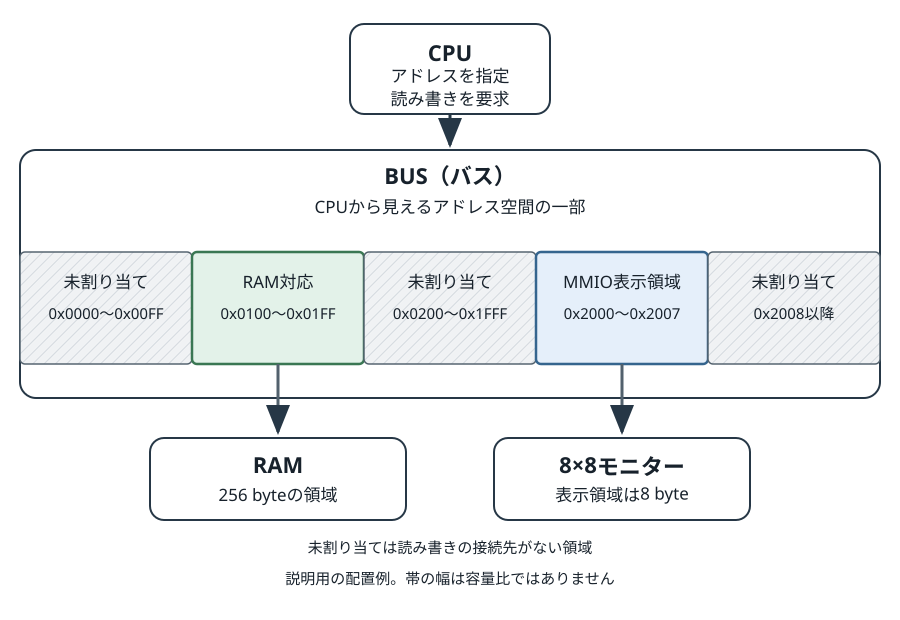
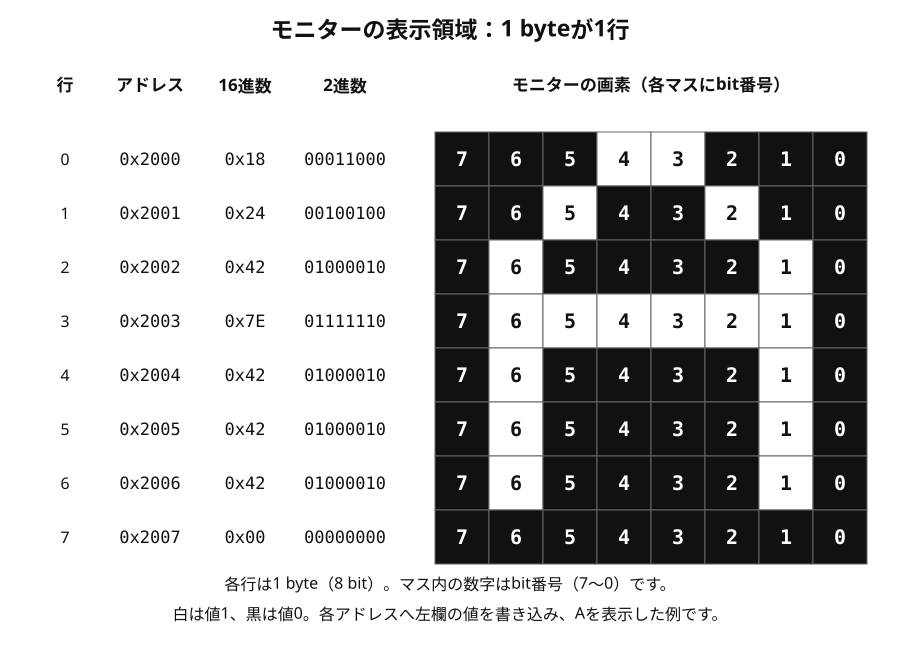

# Ondの思想

Ondは、CPUが行う計算とBUSの読み書きに注目して手続きを記述する言語です。\
機器やマシンごとの違いをMMIOで吸収することで、多種多様な機器を柔軟に接続すると同時にCPU側のシンプルな手続きのみに注目してコードを記述できます。

## BUSとMMIO

CPUと機器（RAMやモニター、キーボード入力など）を配線する仕組みをBUS（バス）と呼び、
CPUはBUSを通じて他のデバイスとデータをやり取りします。\
例えば以下のように RAMと8x8ピクセルのモニターが繋がったマシーンについて考えます。

この例では0x2000から0x2007へ左欄の値を書き込み、Aを表示しています。

### RAMへの書き込みもモニターの表示も、CPUは全く同じ操作で実現する
この例では`0x0100`から`0x01FF`がRAMにつながり、`0x2000`から`0x2007`がモニターの表示領域につながっています。\
CPUが`0x0100`へ`0x18` (`0b00011000`)を書き込むとRAMはその数値を記録します。\
同じ値を`0x2000`へ書くと、モニターは最上行の中央2画素を白にします。\
CPUの操作はどちらもアドレスを指定して値を書くことですが、結果は接続先によって変わります。

このようにCPUから見える接続機器のすべてをメモリの読み書きに見立てて制御する仕組みを、Memory-Mapped I/O（MMIO、メモリマップドI/O）と呼びます。\
RAMと機器の窓口は同じアドレス空間に並んでおり、 CPUからはどんな機器もすべて共通の方法で制御できます。

MMIOを使えば、CPUやコンパイラーにモニター制御専用命令を加えず、CPUが本来持つメモリの読み書きと同じ操作で画素を操作できるのです。\
一方どのアドレスを使い、各bitを何に使うかは機器ごとに決める必要があります。\
その仕様を知るコードを用意すれば、機器固有の扱いをそこへ集める事が可能です。

今回は簡単なモニターを例に説明しましたが、ボタンの ON/OFF を `0x3000` に対応させれば、そこを読むことでCPUからボタンのオンオフを検出できますし、\
これをキーボードのキーの数だけアドレス空間にマッピングすれば、キーボード入力をCPUが受け取る事も可能になるわけです。

## Ondが受け持つ範囲

Ondで書くのは、今回の例に照らすと画素のデータを作りMMIOのアドレスへ値を書くまでのCPU側の手続きです。\
受け取ったbitに従って画素を白黒にするのはモニター側の回路です。\
画素の形を作る一般的な処理と、特定のモニターのアドレスやbitの意味を知る専用関数・ライブラリを分ければ、一般処理を機器の違いから離して使えます。

プログラムがアドレス`0x2000`を直接使えば、そのアドレス配置を持つ機械への依存は残ります。\
そのため同じバイナリがあらゆる機械でそのまま動くとは限らないことには注意が必要です。

## 起動にも機械ごとの準備がある

コンパイルとリンクは、命令やデータをバイナリファイルにまとめます。\
ファイルを作った後は、実行環境の起動処理が命令やデータを配置して初期化し、CPUが起動入口からプログラムを始められる状態にします。\
配置や起動開始位置は機械の構造によって異なります。

Ondの起動入口はプログラム全体で使う変数を定められた順に初期化し、その後`main`を呼び出します。\
具体的なビルドと起動準備は[ビルドと起動の手順](build-and-launch.md)、最初のプログラムを作る手順は[最初のプログラム](first-program.md)を参照してください。
